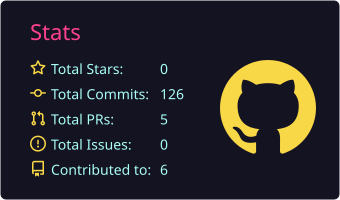
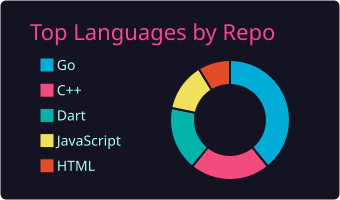

## Hi there, I'm Whisnu 👋

👨‍💻 **Informatics Student**

🚀 Interested in **Software Engineering** and building real-world applications

📫 **Reach me at:**
[LinkedIn](https://linkedin.com/in/ananda-whisnu-nurhidayat-6556681b1) • [Email](mailto:anandawhisnuuu@email.com)

---

### 🛠️ Tech Stack

* **Languages:** C++, Go
* **Tools:** Git, GitHub, VS Code
* **Concepts:** Data Structures, OOP, Basic Algorithms

---

### 📊 GitHub Stats

  
  

---

### 🧠 Language Usage

  
 

---

### 📌 Current Focus

* Strengthening fundamentals in **Data Structures & Algorithms**
* Building small projects to improve **problem-solving skills**
* Consistently documenting learning progress on GitHub

---

✨ *"Learning by building, growing by consistency."*
